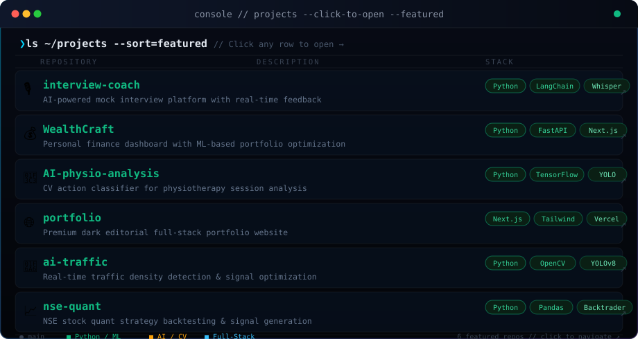

<!-- ═══════════════════════════════════════════════════════════
     Saksham Aggarwal — GitHub Profile README
     AI Engineer & Data Scientist | GGSIPU, New Delhi
     ═══════════════════════════════════════════════════════════ -->

<!-- ▌ BANNER ───────────────────────────────────────────────── -->

  

<!-- ▌ TYPING HEADLINE ────────────────────────────────────────── -->

  

 

<!-- ▌ HERO: TERMINAL ART + INFO CARD ─────────────────────────── -->

  <table align="center" border="0" cellpadding="0" cellspacing="12">
    <tr>
      <td valign="top" align="center">
        
      </td>
      <td valign="top" align="center">
        
      </td>
    </tr>
  </table>

 

---

<!-- ▌ CONTRIBUTION HEATMAP ───────────────────────────────────── -->
### 📈 &nbsp;`$ saksham@github ~ $ ./contributions.sh`

  

---

<!-- ▌ ACHIEVEMENTS DASHBOARD ────────────────────────────────── -->
### 🏆 &nbsp;`$ cat achievements.log --visualize`

  

---

<!-- ▌ PROJECTS ────────────────────────────────────────────────── -->
### 🚀 &nbsp;`$ ls ~/projects --featured --sort=stars`

  

---

<!-- ▌ TECH STACK ─────────────────────────────────────────────── -->
### ⚡ &nbsp;`$ cat tech-stack.md`

  

  
  &nbsp;
  
  &nbsp;
  
  &nbsp;
  

---

<!-- ▌ GITHUB STATS ─────────────────────────────────────────── -->
### 📊 &nbsp;`$ git stats --analytics`

  
  &nbsp;
  

  

---

<!-- ▌ SOCIALS ────────────────────────────────────────────────── -->
### 📬 &nbsp;`$ open --socials`

  
  &nbsp;
  
  &nbsp;
  
  &nbsp;
  

  

 
